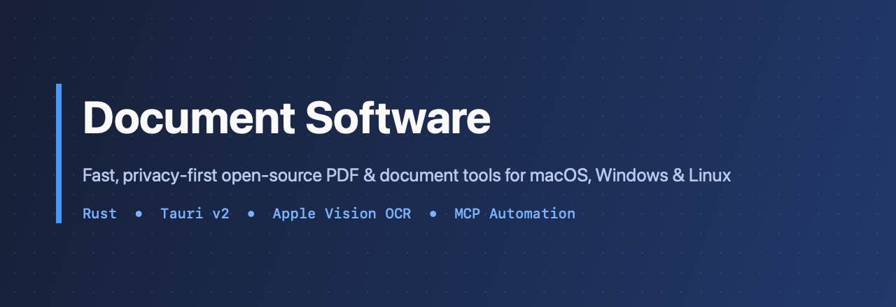

  

# Document Software

**Fast, privacy-first open-source PDF and document utilities** for **macOS, Windows, and Linux** — built with **Rust**, **Tauri v2**, **PDF.js**, **pdf-lib**, **lopdf**, and on-device **Apple Vision OCR**.

Zero cloud uploads. Zero subscriptions. Full local control.

## Featured Projects

| Project | Description | Platform | Stack |
| :--- | :--- | :--- | :--- |
| **[Mac PDF Editor](https://github.com/document-software/mac-pdf-editor)** | Lightweight (~6 MB) desktop PDF editor with direct text replacement, background color sampling, offline macOS Vision OCR, signing, merging, compression, and built-in MCP/HTTP API | macOS, Windows, Linux | Rust, Tauri v2, React, PDF.js, pdf-lib, lopdf |

## Links

- 🌐 **Website & Guides (20 pages):** [https://document-software.github.io/mac-pdf-editor/](https://document-software.github.io/mac-pdf-editor/)
- 📦 **Latest Releases:** [https://github.com/document-software/mac-pdf-editor/releases](https://github.com/document-software/mac-pdf-editor/releases)
- 📄 **MIT Licensed:** Free for personal and commercial use.
